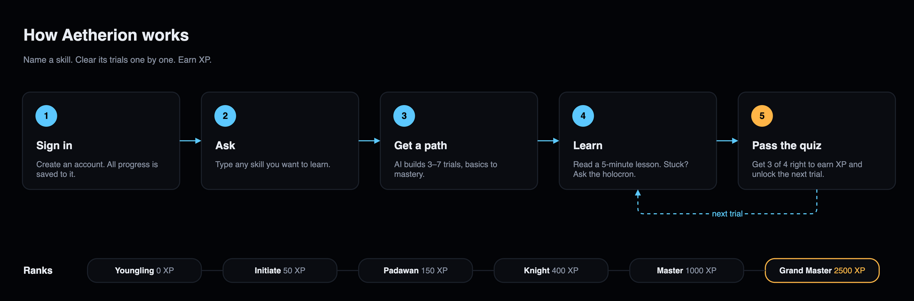
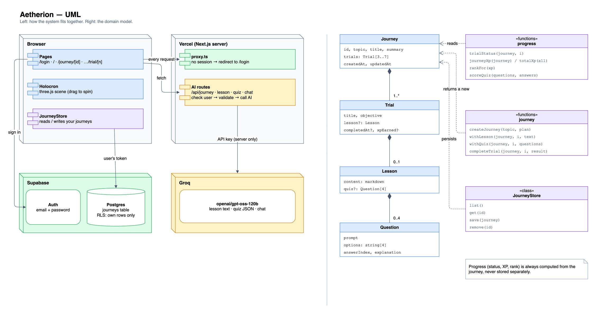

# aetherion

Aetherion is a Star Wars–inspired AI learning platform — a digital holocron for the modern age. It transforms knowledge into an epic journey, guiding learners with adaptive wisdom, bridging ancient lore and cutting-edge technology to help you master any skill across galaxies of information.

> **Non-commercial fan project.** Aetherion is free and made for learning; nothing is sold. It is not affiliated with, endorsed or sponsored by Lucasfilm Ltd. or The Walt Disney Company. Star Wars and related names are trademarks of Lucasfilm Ltd.

## How it works



## Architecture



- **Accounts are required.** `proxy.ts` sends signed-out visitors to `/login`. The AI routes check the session again, so only members spend the AI quota. Postgres row-level security means each user can only read and write their own journeys.
- **The AI key never reaches the browser.** Four route handlers (`/api/journey`, `/api/lesson`, `/api/quiz`, `/api/chat`) validate input with zod before calling Groq.
- **One document per journey.** Lessons and quizzes are saved inside the journey once generated, so revisiting a trial costs no AI calls. Progress, XP and rank are always computed from it ([`src/lib/domain`](src/lib/domain), unit-tested).

Both PNGs embed their draw.io source. Open one in [draw.io](https://app.diagrams.net) to edit it, then export as PNG with *Include a copy of my diagram* ticked.

## Stack

Next.js 16 · React 19 · Tailwind CSS 4 · react-three-fiber · Vercel AI SDK 7 + Groq (`openai/gpt-oss-120b`, free tier) · Supabase (Auth + Postgres) · Vercel

## Run locally

1. Install dependencies:

   ```bash
   npm install
   cp .env.example .env.local
   ```

2. Fill in `.env.local`:
   - `GROQ_API_KEY` ([free key](https://console.groq.com/keys))
   - the two Supabase values (see [Database setup](#database-setup)). If the project is linked to Vercel, `vercel env pull .env.local` fetches them.

3. Start the dev server:

   ```bash
   npm run dev
   ```

Checks:

```bash
npm test
npm run typecheck
npm run lint
npm run build
```

## Database setup

1. Create a Supabase project. The easiest route is **Vercel → project → Storage → Supabase**, which also adds the env vars to Vercel.
2. In **SQL Editor**, run [`supabase/migrations/0001_journeys.sql`](supabase/migrations/0001_journeys.sql).
3. In **Authentication → URL Configuration**:
   - set **Site URL** to the production URL
   - add `http://localhost:3000/**` and `https://*.vercel.app/**` to **Redirect URLs**
4. In **Authentication → Sign In / Providers → Email**, choose how sign-up confirms:
   - **Off:** turn off *Confirm email* and users are signed in right after registering.
   - **On:** set up custom SMTP. Supabase's built-in mailer only sends to your own team's addresses.

## Deploy

The Vercel project is connected to this GitHub repository: every push to `main` deploys to production, and every pull request gets a preview URL. The project needs three environment variables:
- `GROQ_API_KEY`
- `NEXT_PUBLIC_SUPABASE_URL`
- `NEXT_PUBLIC_SUPABASE_ANON_KEY`

## Credits

- [“Holocron”](https://sketchfab.com/3d-models/holocron-bb1d39d2a3854fecac4760bcc219e2ac) 3D model by [brq327](https://sketchfab.com/brq327), licensed under [CC BY 4.0](https://creativecommons.org/licenses/by/4.0/). Materials were modified for this project.
- Star Wars, Jedi, Padawan and related names are trademarks of Lucasfilm Ltd., used here non-commercially by a fan.
